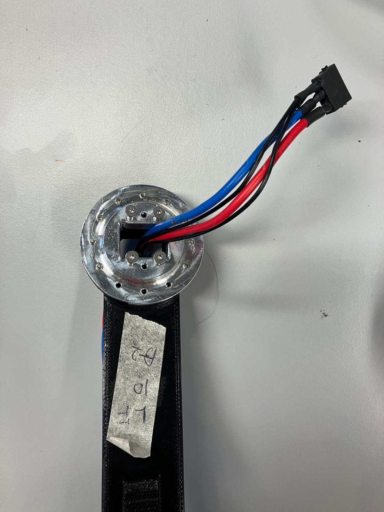
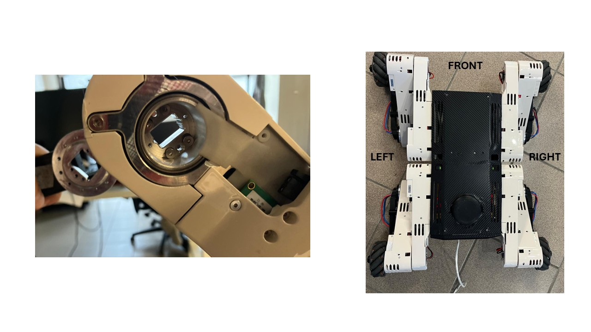
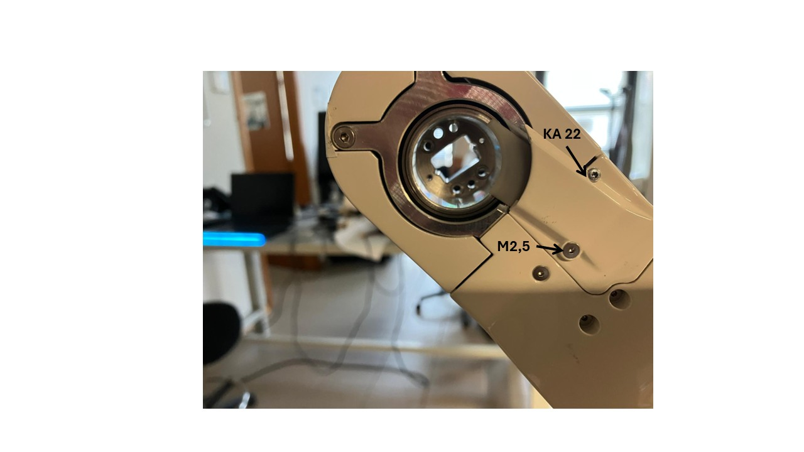
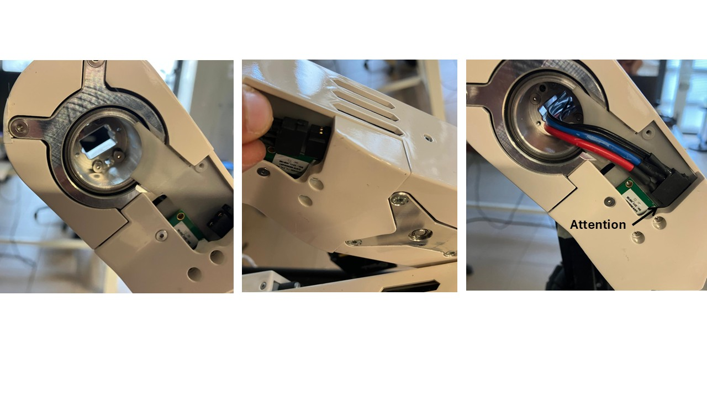
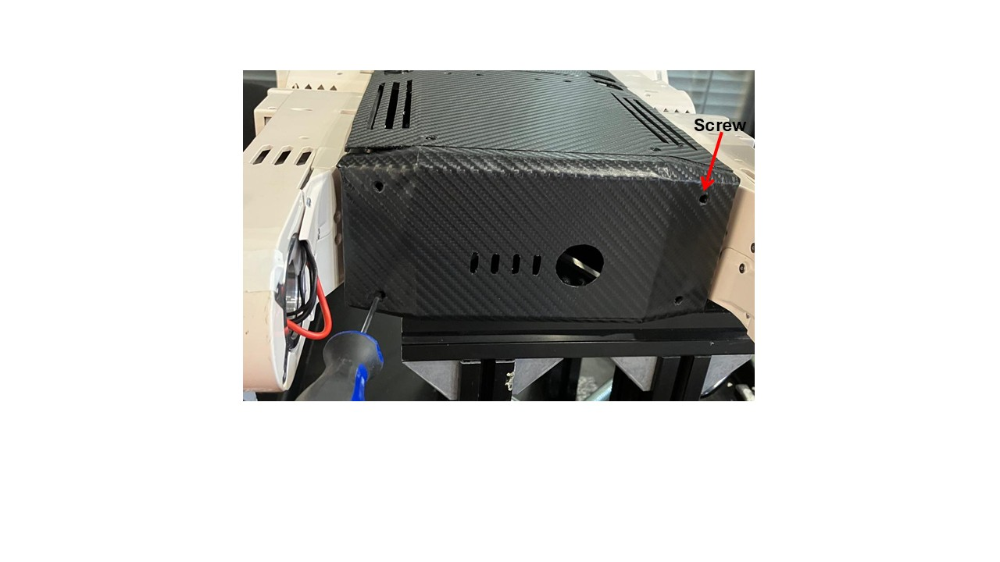
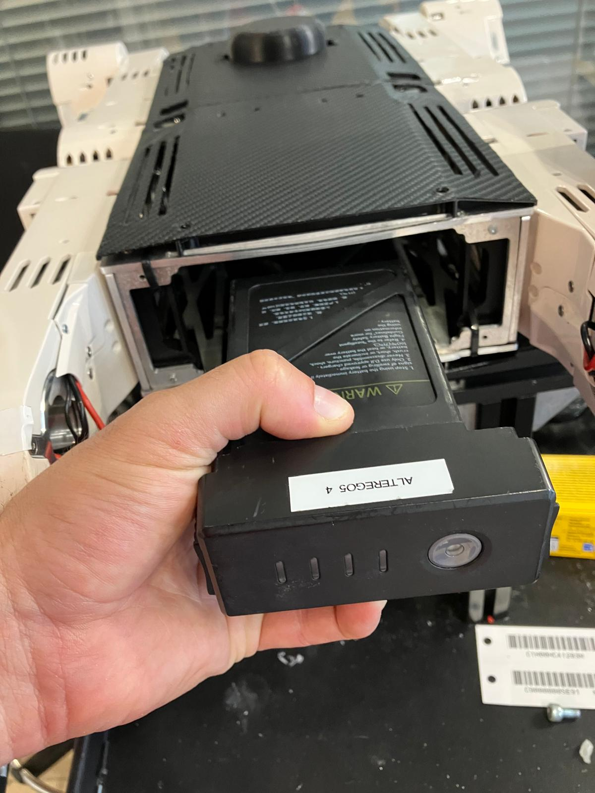
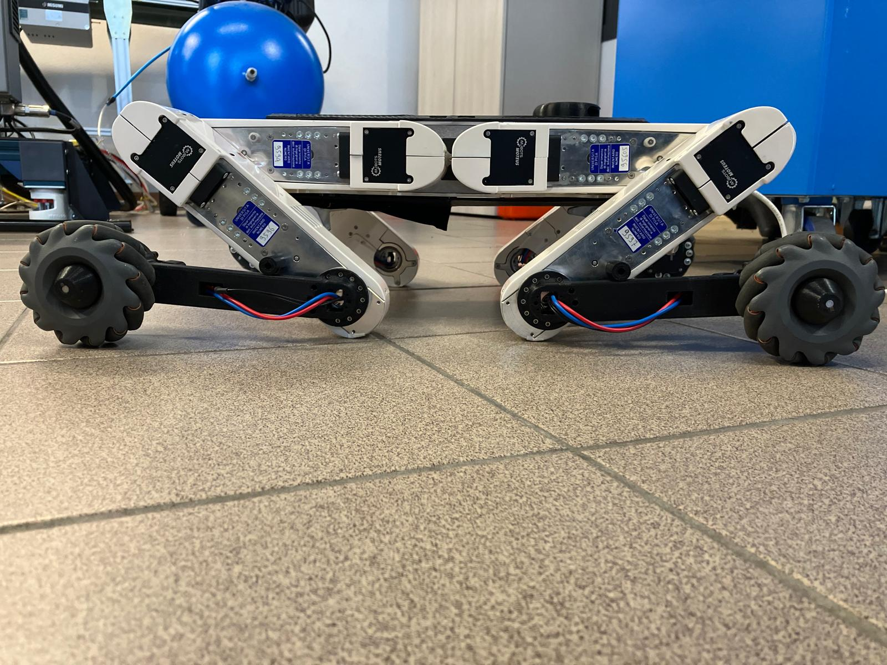

# OmniQuad Guide - Version 2

## 1. Robot Assembly

### 1.1 Unpack the Robot

1. Open the transport box.
2. Remove the robot from the box.
3. Remove the two wheel links together with their protective bags.
4. Remove all transport packaging materials.

⚠️ Do not throw away the packaging materials.
They will be required again for future transport and storage of the robot.

---

### 1.2 Install the Wheel Links

For each wheel link:

1. Remove the M2.5 countersunk screws from the wheel link interface.

These screws will later secure the coupling between the wheel link and the knee interface.



2. Correctly position the wheel link on the robot.

⚠️ Wheel links are side-dependent:

* both links are either right-side links
* or left-side links

Also pay attention to whether the wheel link is mounted on:

* the front knee
* or the rear knee



3. Route the cable through the knee structure.

4. Align the mechanical interfaces between the wheel link and the knee.

5. Attach the wheel link to the knee.

6. Manually tighten the M2.5 countersunk screws in their dedicated seats.

⚠️ Tighten carefully.
The screws can strip easily if overtightened.

<!--  -->

---

### 1.3 Connect the Wheel Link Electronics

For each knee:

1. Open the knee protective cover by removing the corresponding screws.



2. Connect the wheel link connector to the knee connector.

⚠️ Pay attention to connector orientation.
Incorrect insertion can bend or damage the data pins.



3. Close the knee protective cover.

⚠️ Do not overtighten the cover screws.
The plastic cover may crack or break.

4. Repeat the procedure for both knees.

---

## 2. Battery Installation / Replacement

### 2.1 Remove the Front Cover

Remove the front cover.

The cover is secured using two self-tapping screws mounted diagonally.

Use the blue screwdriver provided with the robot.



---

### 2.2 Insert the Battery

Take the battery and insert it in the correct orientation.



⚠️ Make sure the battery is inserted from the correct side.

Push the battery fully into its compartment.

⚠️ If the battery does not fully enter the compartment, it may be slightly swollen.

In this case, gently press on the upper side of the battery with your finger while inserting the final portion.

---

### 2.3 Turn On the Battery

Once the battery is connected:

* perform one short press on the battery button
* immediately follow with one long press for a few seconds

The battery will power on.

<!--  -->

---

### 2.4 Reinstall the Front Cover

After the battery is turned on, reinstall the front cover using the same screw locations as before.

⚠️ Tighten the screws diagonally and do not overtighten them.

---

### 2.5 Turn Off the Battery

If the battery is already installed and you only want to turn the robot on or off:

* use the long screwdriver to access the battery button
* perform the same procedure used for power on/off:

  * one short press
  * followed by one long press

---

## 3. Robot Startup and Connection

### 3.1 Initial Robot Position

Place the robot in the startup configuration shown below.



---

### 3.2 Power On the Robot

Turn on both distributor switches.

⚠️ The left switch powers the Raspberry Pi.
If the robot must remain powered and ready for use while saving battery, it is possible to leave only the left switch turned on.

<!--  -->

⚠️ After powering the robot on, wait for the Raspberry Pi and onboard computers to fully boot before continuing.

This process may take up to a few minutes.

---

### 3.3 Connection Methods

Two different connection methods are available:

* Ethernet connection
* WiFi Access Point connection

---

### 3.4 Ethernet Connection

Connect the robot directly to the PC using an Ethernet cable inserted into the rear cover Ethernet port of the robot.

The robot IP address is:

```bash
100.100.100.X
```

where `X = 2` for this robot version.

Connect through SSH:

```bash
ssh mulsbc@100.100.100.X

# Example for this robot:
ssh mulsbc@100.100.100.2
```

---

### 3.5 WiFi Access Point Connection

Connect the PC to the robot WiFi network.

WiFi credentials:

```text
SSID: Mulinex_X
Password: 1234567890
```

where `X = 2` for this robot version.

Once connected, access the robot through SSH:

```bash
ssh mulsbc@192.168.X.1

# Example for robot version 2
ssh mulsbc@192.168.2.1
```

where `X` depends on the robot version.

---

### 3.6 SSH Login

When prompted, enter the robot password:

```text
123456
```

Once logged in, the robot startup helper script will begin the initialization procedure automatically.

During the first startup, the Raspberry Pi may require synchronization confirmation.

If prompted, type:

```bash
yes
```

and press Enter.

The startup procedure will then perform several automatic checks:

* internal storage availability
* old ROS bag recordings
* available free disk space

If the available storage is below the required threshold, the system may ask permission to delete old bag files to free space.

If prompted and the recordings are not needed, type:

```bash
yes
```

The system may also detect multiple old bag recordings (more than one) and ask whether they should be removed.

Delete them only if they are no longer required.

---

After the checks are completed, enter superuser mode:

```bash
sudo su
```

The terminal will automatically move to the robot workspace.

Then start the robot hardware interface using:

```bash
ros2 launch pi3hat_hw_interface moteus_pi3hat_interface.launch.py urdf_file:=omniquad12_dji.xacro conf_file:=omniquad12_dji.yaml
```

---

Once the hardware interface is running, the robot is ready for operation.

---

## 4. PC-Side Control Interface Startup

First of all, connect the joystick to a USB port on the operator PC.

1. Open a terminal.
2. Navigate to the Docker workspace:

```bash
cd ~/ICRA_2026/docker_nuc_mulinex
```

3. Enter the Docker container:

```bash
./docker/run.bash
```

4. Once inside the container, start the joystick interface package:

```bash
ros2 launch omni_bringup omni_bringup.launch.py [record_bag:={false}]
```

This package enables the joystick control interface for the robot and set true in the command above to enable bag recording on the OPC.
---

## 5. OmniController Usage

Initially, the OmniController is disabled.

To activate the robot:

* Press `L1`

The robot knees will slightly rise, and the robot can now move on the plane.

---

### 5.1 Raise the Robot

Press:

* `Triangle`

The robot will raise its base, maintain a fixed standing configuration, and can move in the planar directions.

---

### 5.2 Enable Base Motion (Inverse Kinematics)

To enable full base motion control, press:

* `Square`

⚠️ Press this button only once.

This enables the inverse kinematics controller, allowing full base motion control.

Refer to the terminal command section for the available motion commands.

---

### 5.3 Reset Base Position

To reset the robot base to its default configuration, press:

* `R3`

If the reached position does not have a planar base configuration, press the triangle button to bring the robot back to the stand position.

### 5.4 Demo Mode

To start the demo mode, press:

* `SHARE`

The `SHARE` button is located on the left side of the controller touchpad.

The demo can be started from any robot configuration or position.

Before starting the demo, make sure there is at least:

* 0.5 meters of free space in front of the robot
* 0.5 meters of free space on its right side

The demo can be stopped at any moment by pressing the `SHARE` button again.

---

### 5.5 Rest Mode
The robot can be placed into a safe resting configuration using the joystick controls.

This mode is useful when:

* temporarily stopping robot operation
* preparing for shutdown
* safely handling the robot
* reducing actuator effort while stationary

Press:

* `X`

to move the robot into the resting configuration.

In this mode, the robot returns to its initial startup position and the controller is deactivated.

⚠️ Use this mode whenever actuator temperature becomes too high or when the robot must remain powered on without active control.

---

### 5.6 Emergency Stop Button

Press:

* `R1`

to instantly deactivate the controller.

⚠️ Use this function only in case of a real emergency.

If the robot is standing, the immediate controller deactivation will cause the robot to fall to the ground without damping.

Do not use `R1` for the normal controller shutdown procedure.

To correctly deactivate the controller, use the `X` button instead, otherwise the knees may violently hit the ground.


---

## 6. Robot Shutdown Procedure

1Before shutting down the robot:

1. Move the robot into the resting configuration by pressing:

   * `X`

2. Wait until the robot is fully resting on the ground.

⚠️ Do not use the emergency stop button (`R1`) for normal shutdown.

---

### 6.1 Stop the Hardware Interface

On the Raspberry Pi terminal running the hardware interface, press:

```bash
CTRL + C
```

Then shut down the onboard computer:

```bash
sudo shutdown -h now
```

---

### 6.2 Wait for Shutdown Completion

Wait approximately one minute for the shutdown procedure to complete.

⚠️ Never disconnect power before shutdown is fully completed.

---

### 6.3 Turn Off Robot Power

1. Turn off the distributor switches.
2. Turn off the battery following the battery shutdown procedure.

The robot is now fully powered off and safe for transport.

---

## 7. Robot Disassembly for Transport

⚠️ Before starting the disassembly procedure, follow the robot power off procedure described in the dedicated section.
---

### 7.1 Remove the Wheel Links

For each wheel link:

1. Remove the knee protective cover.
2. Disconnect the wheel link connector.

⚠️ Do not pull directly from the wires.

<!--  -->

3. Remove the M2.5 countersunk screws.
4. Remove the wheel link.
5. Reinstall the screws into the wheel link threaded holes to avoid losing them.
6. Reinstall the corresponding knee covers as well, without overtightening the screws, since the covers can break.

<!--  -->

---

### 7.2 Pack the Removed Components

Place the wheel links inside their protective bags.

Wrap and protect the remaining robot structure using the original packaging materials.

---

### 7.3 Position the Robot Inside the Transport Box

Place the support stand ("altarino") inside the transport box.

<!-- Position the robot on top of the stand with the legs folded as shown below. -->

<!--  -->
